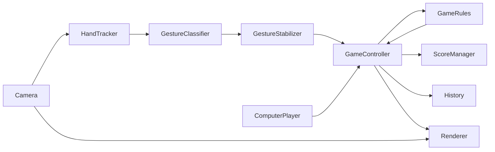

# HandPlay architecture

- **Camera** opens the configured webcam, returns frames, and reports read failures as `None`.
- **HandTracker** detects hand landmarks, selects the largest bounding-box hand, and can draw its skeleton.
- **GestureClassifier** maps a hand's landmarks to Rock, Paper, Scissors, or Unknown.
- **GestureStabilizer** uses a rolling majority of recent gestures to suppress flicker.
- **GameController** coordinates game states, round timing, accepted moves, results, and match flow.
- **ComputerPlayer** chooses a random valid move for each round.
- **GameRules** determines the result from the player's and computer's moves.
- **ScoreManager** counts player wins, computer wins, draws, and completed rounds.
- **History** retains recent round moves and results.
- **Renderer** draws the desktop game's screens, controls, game information, and camera status.
