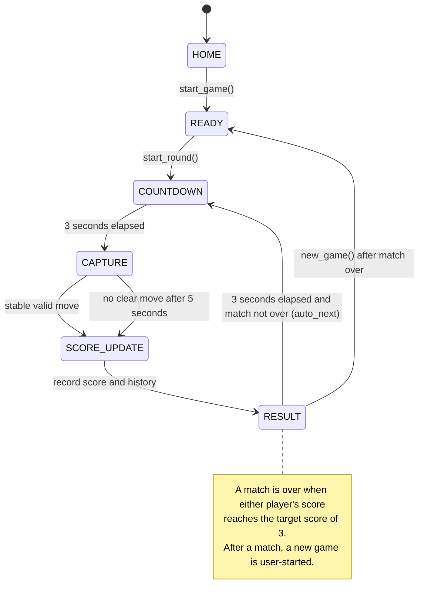

# Game state diagram

The controller enters `SCORE_UPDATE` while recording the completed round, then immediately enters `RESULT`. If the target has not been reached, automatic play starts the next round after the three-second result interval; a new match resets the scores and returns to `READY`.
